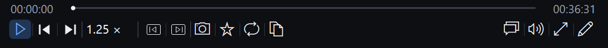
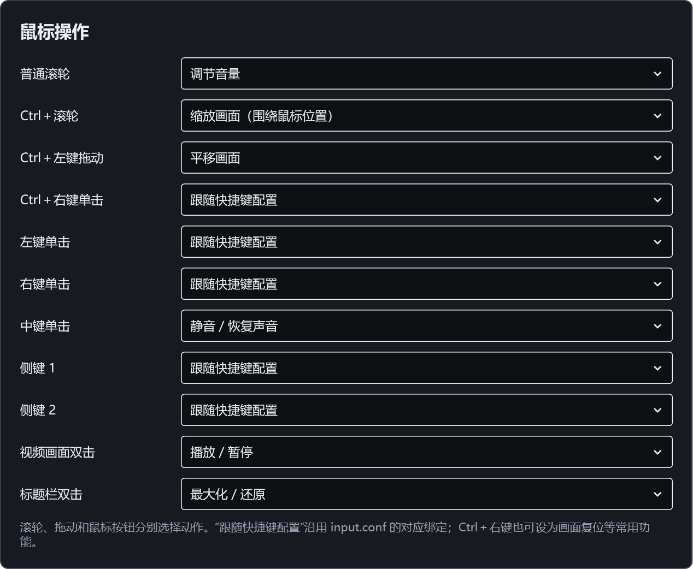
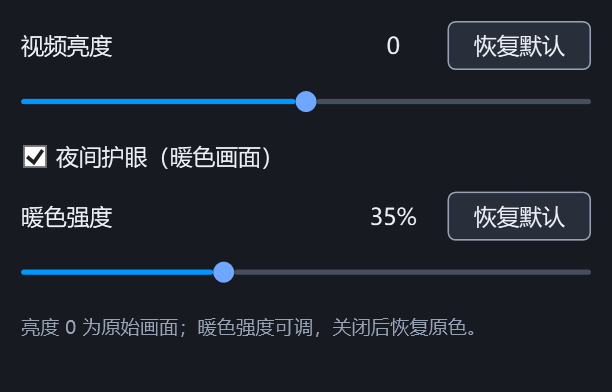

# FrameFlow 视频播放器

FrameFlow 是基于 mpv.net 修改的 **Windows x64 桌面视频播放器**，适合日常播放、课程学习和逐帧查看。它将精确倍速、长按快进、播放断点、书签、截图，以及常用的键盘与鼠标操作集中到一套中文界面中。

当前版本 **V27**，文件版本 `7.1.2.1027`。界面使用 `#0096FF` 蓝色标题栏、深色控制条和蓝色播放图标。

**公开源码仓库：[lingqifeng0/FrameFlow](https://github.com/lingqifeng0/FrameFlow)**。无需登录即可查看源码、功能介绍和界面截图。目前尚未上传 GitHub Release 附件；下文的便携包名称指本地构建产物。原项目来源、许可证及完整软件包对外分发前待核对的事项见[开源声明](docs/open-source-notices.md)。

## 功能概览

| 功能 | 可以做什么 |
| --- | --- |
| 精确播放倍速 | 在 **0.25–16.00 倍**之间调整，支持两位小数、调整步长与退出后记忆 |
| 三套独立倍率 | 普通播放、方向键快进／快退、独立长按快进分别设置，互不相乘 |
| 轻点与长按导航 | 左右键轻点小步定位，按住连续向前／向后，实时显示位置变化 |
| 播放断点与书签 | 记住每个视频的播放位置，添加书签，复制回看时间戳 |
| 逐帧与区间循环 | 上一帧、下一帧、AB 循环、跳到指定时间与章节 |
| 自定义底部工具栏 | 添加、删除、排序和设置按钮参数，最多 **16 个自定义槽位** |
| 快捷键与鼠标设置 | 集中修改常用按键、滚轮、鼠标按钮及双击动作，提示重复绑定 |
| 音量增强 | 普通上限 100%，开启增强后可自行调到 **300%** |
| 视频画面调节 | 调亮／调暗视频，开启夜间暖色，调整暖色强度 |
| 画面缩放与平移 | 围绕鼠标位置缩放、拖动查看局部，一键复位 |
| 视频截图 | 选择含／不含字幕，预览后保存 PNG／JPEG 或复制到剪贴板 |
| 播放列表与多窗口 | 同目录视频、顺序／循环／随机播放，以及独立进程播放窗口 |
| 统一中文设置 | 分类设置、全局搜索、单项恢复默认和所有设置一键恢复 |

## 播放与导航

### 精确倍速与独立长按快进

点击底部倍率按钮可展开紧凑调节面板，通过数值输入或滑杆设置速度。普通播放支持 `1.34×`、`12.34×` 等两位小数；调整步长可选 `0.01`、`0.05`、`0.10`，并可记住退出前的速度。

三套倍率分别保存。以下数值是新配置或恢复默认后的值，升级时已有的自定义值会保留。

| 设置 | 默认值 | 生效方式 |
| --- | --- | --- |
| 底部普通播放倍率 | **1.00×** | 平时持续播放使用的速度 |
| 方向键快进／快退倍率 | **6.00×** | 长按右键按设定倍率向前播放；长按左键连续定位到更早画面，目标为每秒回退 6 秒 |
| 独立长按快进倍率 | **3.00×** | 默认长按 **Tab** 临时按 3 倍播放，按键和倍率均可修改 |

例如，底部设为 `1.25×`、方向键设为 `6.00×`，按住右方向键时就按 **6 倍**播放。松开后恢复原来的 `1.25×`；独立长按键使用自己的倍率。长按结束时也会恢复原来的暂停状态。

### 方向键轻点与长按

- **轻点左／右方向键**：松开时向后／向前定位一次。
- **持续按住左／右方向键**：超过约 **180 毫秒**后进入连续快退／快进，保持原有的轻点、长按判断方式。
- **轻点位移可计算、可预览**：在“设置 → 快捷键与鼠标 → 快进倍率”中设置“轻点计算时长”，界面会显示换算后的移动秒数。

```text
轻点一次移动秒数 = 方向键倍率 × 轻点计算时长（毫秒）÷ 1000
默认：6.00 × 500 ÷ 1000 = 3 秒
```

“轻点计算时长”只用于换算位移，**不会把长按触发门槛改成 500 毫秒**。方向键默认行为不使用固定 5 秒或 30 秒跳转。Tab 的独立长按功能只负责临时快进，轻点 Tab 不执行方向键式定位。

连续操作时，进度条、时间读数和左上角位置提示同步更新；松开、切换视频或失去焦点会结束长按。向后操作通过连续精确定位实现，实际流畅程度受视频编码、关键帧间隔和解码性能影响。

### 断点、书签、逐帧与 AB 循环

- **播放断点**：记录每个视频的实际播放位置，再次普通打开时继续；明确指定的时间戳跳转优先。
- **书签与时间戳**：保存需要回看的位置，从书签列表返回，或复制时间戳用于笔记回看。
- **逐帧查看**：上一帧、下一帧与上一个／下一个视频使用不同图标；逐帧操作会暂停播放。
- **AB 循环**：重复播放选定片段，也可使用单个视频循环或整个列表循环。
- **位置反馈**：定位后在视频左上角显示含毫秒的时间和百分比，约 3 秒后收起；可在“画面提示”区域关闭。

拖动进度条时，滑块跟随指针移动，松开后提交精确定位，避免等待解码时跳回旧位置。

## 自定义工具栏



底部固定保留播放／暂停、切换视频、倍率及常用窗口操作，中间的自定义区域可按自己的使用习惯安排。

- 可添加、删除、排序按钮，切换为仅图标或图标加文字。
- 提供逐帧、书签、截图、AB 循环、字幕、音轨、画面调整和窗口操作等分类。
- 部分按钮可以设置自己的参数，例如跳转时长、指定播放倍率或字幕延迟步长。
- 最多添加 **16 个自定义按钮**；用满后需先删除已有按钮再添加。
- 空槽位不绘制分割线；窗口变窄时，多出的按钮按原顺序收入“更多”。

可用操作与参数范围见[详细使用说明](docs/modern-player.md)。

## 快捷键与鼠标

“设置 → 快捷键与鼠标”集中提供 **26 项常用功能**的键盘绑定。可以录入／修改组合键、清除绑定和恢复原绑定，重复使用按键时会提示冲突。

常用默认操作如下；手动改键或导入旧配置后，以设置页中的实际绑定为准。

| 操作 | 默认按键／鼠标动作 |
| --- | --- |
| 播放／暂停 | `Space`，或双击视频画面 |
| 向前／向后导航 | `→`／`←`，区分轻点和长按 |
| 独立长按快进 | 按住 `Tab` |
| 上一帧／下一帧 | `,`／`.` |
| 进入／退出全屏 | `Enter` |
| 打开视频 | `O` |
| 打开设置 | `Ctrl + ,` |
| 画面缩放 | `Ctrl + 滚轮` |
| 平移画面 | `Ctrl + 左键拖动` |
| 还原画面缩放与位置 | `Ctrl + 0` |
| 最大化／还原窗口 | 双击标题栏 |

鼠标动作统一按“**操作 → 执行动作**”设置，显示提示另设区域：

- 普通滚轮与 Ctrl＋滚轮可分别选择调音量、缩放画面、调倍率、前进／后退、不执行操作或跟随快捷键配置。
- Ctrl＋左键拖动可选择平移画面、关闭或跟随快捷键配置。
- Ctrl＋右键、普通左键／右键／中键及侧键可分别选择常用动作。
- 视频画面双击与标题栏双击分别设置，不互相绑定。
- “画面提示”单独控制左上角定位时间与百分比的显示。



**Esc 保留界面取消作用**：关闭菜单、收起弹层、清空设置搜索或关闭对应窗口。V27 默认不让 Esc 退出播放器，也没有新增 Esc 退出全屏。右键菜单不显示可能与改键结果不一致的快捷键提示，实际按键以设置页为准。

## 声音与画面

### 音量增强

点击音量按钮展开滑杆，可调音量或静音。默认上限为 **100%**；开启“声音增强”后，上限扩展到 **300%**，再自行拖动调节。

开启增强会保留当前音量，例如原先 `75%`，开启后仍为 `75%`。关闭增强时，超过 `100%` 的音量回到 `100%`。选择了调音量动作的滚轮与音量快捷键也使用相同上限。

### 亮度与夜间暖色

在“设置 → 常规 → 画面调节”中修改，或通过视频右键菜单打开紧凑面板；也可将入口加入工具栏、分配快捷键。



- **亮度**：范围 `−100～100`，`0` 为原始亮度，可单独恢复默认。
- **夜间护眼（暖色画面）**：默认关闭，开启后可在 `0～100%` 间设置暖色强度，默认 `35%`。
- 亮度与暖色强度分别保存，修改后即时生效，切换视频与重启后继续沿用。
- 关闭夜间模式恢复原色并保留上次强度；只改变播放器中的视频色彩。

画面操作还包括缩放、平移、旋转、比例调整、对比度与饱和度；字幕和音频可以切换轨道、调整同步。相关功能需要视频具有对应内容。

### 截图预览与保存

可选择**含字幕**或**不含字幕**截图。截图先进入预览窗口，再选择保存 PNG／JPEG，或复制到剪贴板后粘贴到笔记等软件中。

截图按视频画面分辨率生成，不包含播放器工具栏。预览窗口显示画面尺寸和截图位置时间，方便核对。

## 播放列表与多个视频窗口

通过打开按钮或拖放文件开始播放；一次打开多个视频可组成播放列表，也可将当前目录的视频加入列表。支持顺序播放、单个循环、列表循环、随机播放和播完当前就停。

需要同时播放两个或更多视频时：

1. 打开“**设置 → 常规 → 打开文件时的进程方式**”。
2. 选择“**独立进程（multi）**”并完成设置。
3. 从资源管理器或外部命令再次打开视频，创建独立播放窗口。

“单进程（single）”会把外部文件转交给已有窗口。在现有窗口内通过打开按钮或播放列表选择另一个文件，仍然切换该窗口的视频。

## 窗口、设置与恢复默认

- **窗口与标题栏**：普通窗口保留小圆角；最大化和全屏时四角变直、完整贴边，恢复普通窗口后恢复圆角。
- **自由拉伸**：四边、四角均可调整；拉伸期间显示随窗口缩放的当前帧预览，声音和进度继续，松开后恢复实时画面。
- **全屏控制**：控制条可自动收起，鼠标移到底部再次显示；标题栏在鼠标移到顶部时显示，也可关闭自动收起。
- **窗口记忆与置顶**：保存普通窗口尺寸，提供还原初始窗口大小和置顶开关。
- **中文分类与全局搜索**：按“倍速”“断点”“截图”“硬解”等关键词或技术参数名搜索，再切换匹配结果进行编辑。
- **单项恢复默认**：只恢复对应设置；倍率、亮度和暖色强度等分别提供恢复入口。
- **恢复所有设置默认值**：覆盖新增及原有偏好，包括倍率、轻点计算、快捷键、鼠标、音量增强、画面、工具栏、窗口和底层配置。恢复前备份配置到 `portable_config/settings-backups/时间戳`，保留播放断点、书签和最近文件。

## 运行与升级

解压本地生成的 **FrameFlow-V27-win-x64.zip**，进入 `FrameFlow` 文件夹并运行 `FrameFlow.exe`。便携包无需安装额外的 .NET；请保留 EXE 旁的 DLL、`portable_config`、许可文本和说明文件。

从旧版升级时：

1. 退出旧播放器，备份旧 `portable_config`。
2. 将整个 `portable_config` 复制到新的 FrameFlow 目录。
3. 启动 `FrameFlow.exe`；首次读取会把 `mpvnet.conf` 复制为 `frameflow.conf`，原文件保留。

两份前端配置同时存在时优先使用 `frameflow.conf`。原有偏好、播放记录、书签及脚本格式继续兼容；新包不附会遮住旧配置的前端默认模板。旧快捷方式仍指向原程序，请使用新的 `FrameFlow.exe` 创建快捷方式。

## V27 本版变化

- 正式使用 **FrameFlow** 名称，包括程序文件、窗口、任务栏、关于界面、设置帮助、文件关联显示名称及发布包。
- 统一最大化／全屏时的窗口外框、蓝色标题栏和系统合成器圆角状态，处理四角露底；普通窗口继续保留圆角。
- 移除 Esc 默认直接退出播放器的绑定，保留已有界面取消行为；旧的普通 Esc 退出绑定在加载时停用，全局恢复默认也不会重新启用。
- 支持旧前端配置复制迁移，并保留历史脚本命令和命名空间的兼容。
- 补充来源、原作者、修改日期、许可证及第三方组件说明。

## 本地构建

需要 Windows x64、Git、Python 3 和 .NET 10 SDK。引导脚本会准备本地 SDK 及原生播放组件；托管依赖由 NuGet 恢复。

```powershell
./scripts/bootstrap.ps1
./scripts/build-portable.ps1
```

构建生成 `dist/FrameFlow/FrameFlow.exe`。本地打包：

```powershell
python ./scripts/package.py
```

生成便携包、前端源码包和 SHA256 校验文件，排除私有配置、播放历史和渲染缓存。版本由项目中的 `ModernVersion` 统一管理，普通编译不会自动增加版本。

## 文档与验证

- [详细使用说明与外部控制接口](docs/modern-player.md)
- [V27 改名、Esc 与最大化圆角验证记录](docs/resize-audit-V27.md)
- [开源声明与修改记录](docs/open-source-notices.md)
- [第三方组件、版本、哈希与许可](docs/third-party.md)

V27 已完成设置模型 138 项、实际界面与输入 126 项、亮度与夜间模式 25 项及重开 2 项检查，并完成两次窗口拉伸共 120 帧的检查。具体范围和限制见验证记录；文档中的界面截图来自本地实际程序。

## 开源来源与许可

FrameFlow 基于 [mpv.net](https://github.com/mpvnet-player/mpv.net) 修改，原作者为 stax76 及项目贡献者。保留原项目的 **GNU General Public License Version 2（GNU GPL v2）** 许可文件与声明，第三方组件分别适用各自许可。FrameFlow 并非原项目官方发行。

完整许可见 [License.txt](License.txt)，修改说明、无担保声明与源码提供要求见[开源声明](docs/open-source-notices.md)。对外分发前仍须核对 GPL／LGPL 版本兼容性，并补齐实际原生依赖所要求的对应源码和构建材料。

本地生成的 **FrameFlow-V27-source.zip** 覆盖本前端及仓库内代码，不等于原生 DLL 与所有依赖的完整对应源码。具体组件、版本、哈希和许可见[第三方组件](docs/third-party.md)。
