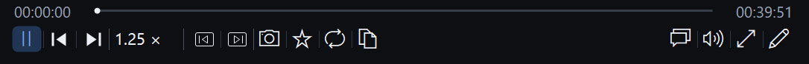
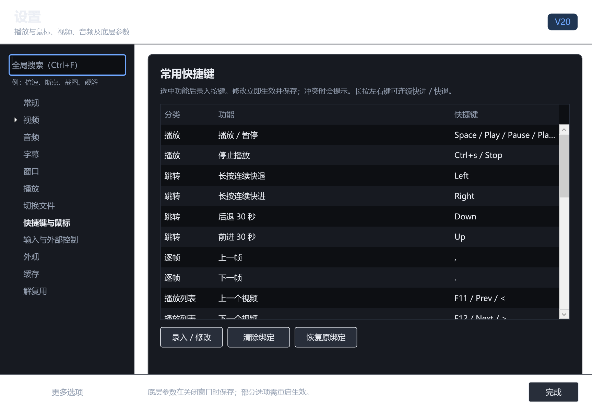

# V20 拉伸、拖动与快捷键检查

检查日期：2026-10-12。构建版本：V20（7.1.2.1020），Windows x64，.NET 10。

## 正常工具栏

默认可编辑区域仍是六个按钮：上一帧、下一帧、截图、书签、AB 循环、复制时间戳。逐帧按钮各一个；切换视频使用另一组固定按钮。16 个槽位是容量上限，未使用的槽位留白，不画线或占位框。

容量测试曾用重复按钮填满槽位并显示出来，造成误解。该测试窗口已关闭，改为 16 种不同功能；正常预览与发行默认配置使用六个按钮。没有把容量测试配置写入现用播放器或发行包。

## 窗口缩放与启动

- GDI 重绘使用 `RDW_NOCHILDREN` 并明确遍历可见的工具栏控件，排除整个 GPU 视频子树；父窗口启用 `WS_CLIPCHILDREN`，视频宿主启用相邻窗口裁剪。原先把 `ERASE` 传播到 GPU 子窗口，会让背景擦除与视频绘制竞争。
- 拖动时标题栏和底栏内容隐藏，保留高度，背景均为纯黑。蓝色栏自身的 Region 更新暂停，普通窗口外框 Region 随尺寸更新，四角始终圆润。
- 尺寸更新按 16 ms 合并，暂停父子布局后一次应用，禁止复制旧像素。松开时应用最后待处理尺寸，在内容隐藏时排列自定义按钮，然后恢复蓝色与按钮。
- 首次 `OnShown` 先绘制工具栏，再进行菜单初始化和打开启动文件，取消现代模式中旧的高度加一、减一刷新方式。

## 灰块来源

本次“硬件工程师培训05-电阻器件的选型_ev.mp4”的第一帧为 1920 × 1080，课程画面及左右黑区都已编码在视频内。使用独立 OpenCV 解码原始第一帧，右侧黑区可见同样的灰色小块及红色图案；mpv 的 GPU 输出截图也包含它。该小块不能作为播放器背景绘制失败的证据。

本地证据：`test-results/appearance-v20/default/source-frame.png`（独立原始帧）、`gpu-output.png`（mpv 输出）和 `video-diagnostics.json`（GPU、D3D11 硬解及原始画面参数）。未裁切或覆盖源视频。窗口边缘残影、内容缺块等属于另外的窗口绘制问题，按上面的修正单独验证。

## 进度、音量与倍率拖动

- 滑块立即显示指针位置，进度预览约 50 ms 合并一次，仅发送最新目标，使用异步关键帧预览；松开提交一次精确定位。
- 解码暂时返回旧时间时不回拉滑块。切换文件或新的定位取消旧拖动目标；捕获丢失会结束拖动。
- 音量与速度约 33 ms 合并一次；抬起和收起面板时提交最终值。当前值和已提交目标分开显示，避免旧属性事件回写。
- 开启声音增强只扩展到 300% 的上限，当前音量不变。关闭时同时夹紧当前值、待发送值和显示值到 100%，防止晚到的 300% 更新重新超限。

异步命令按 [libmpv 官方客户端接口](https://github.com/mpv-player/mpv/blob/master/include/mpv/client.h) 调用，参数提交后由内核复制；指针移动不等待视频解码完成。

## 快捷键与鼠标

独立分类提供 25 项常用功能，支持录入、修改、清除、恢复原绑定和冲突提示。鼠标左键、右键、中键、侧键动作，滚轮音量开关，Ctrl 缩放和平移，双击动作及底层输入重复参数集中在同一页。全局搜索也能定位具体快捷键功能，每次显示一个候选。

改动保存到 `modern-ui.json`，不重写用户的 `input.conf`。已有原生配置仍作为原绑定；只迁移普通 Left/Right 的旧固定 5 秒默认绑定，其他自定义组合键和显式禁用项保留。

默认左右键短按约移动 0.12 秒，按住超过 180 ms 后连续快进或快退。快进使用真实的加速播放，速度为原来的 4 倍、最多 16 倍。快退以约 40 ms 间隔请求当前最新的精确位置，并等待前一次解码；它是连续显示更早画面，流畅度受解码与 GOP 长度影响。按键释放、失去焦点、修改速度、拖动进度和加载新文件均结束连续操作，恢复原速度与暂停状态，不把临时快进速度保存成用户倍率。

输入状态使用 [mpv 官方按键绑定机制](https://mpv.io/manual/master/#command-interface) 的按下、抬起、重复和取消事件。

## 明确时间戳与目录播放列表

回归测试发现：内核 `autocreate-playlist` 会重建包含同目录视频的播放列表，重新载入当前视频，重建条目没有携带原来的显式 `start`，导致新时间戳回到保存断点。初始化完成后强制停用此项，前端只追加目录条目并移动排序，不重载当前条目。普通打开、笔记锚点及同文件零秒起点继续遵循共用断点策略，明确时间戳优先。

这与 [mpv 官方 `loadfile` 说明](https://mpv.io/manual/master/#command-interface) 一致：命令修改播放列表，文件加载另行发生。测试同时覆盖长按快退时打开带起始时间的视频，以及前端自动追加目录条目仍保留当前时间。

## 验证结果

| 验证 | 结果 | 本地记录 |
| --- | --- | --- |
| 设置模型、迁移、共享记录与快捷键目录 | 106 项通过 | `test-results/settings-v20.log` |
| 原生窗口背景重绘与子窗口坐标 | 10 项通过，50 个中间尺寸及 120 个移动/缩放帧 | `test-results/chrome-v20.log` |
| 实际 GPU 窗口连续缩放 | 120 个中间帧、两次手势、图标与文字模式、16 种不同工具、圆角、最终尺寸与溢出检查通过 | `test-results/resize-v20/live/observations.json` |
| 正常六按钮工具栏实际鼠标缩放 | 三次收缩手势，记录无外观状态断言失败 | `test-results/appearance-v20/default/observations.json` |
| 原生按键、拖动和 WPF 设置页 | 36 项通过；连续前后位置、焦点丢失、160 次拖动合并、最终精确位置、音量开关、明确起始时间、目录追加、设置搜索 | `test-results/controls-v20/live/observations.json` |
| 多窗口与打开入口 | 8 项通过；旧窗口不能覆盖新进度、原生旧断点不能覆盖新记录、配置/EXE 精确路由、显式起点及零秒 | `test-results/resume-audit-v20/results.json` |

构建完成，无编译错误；保留上游已有的可空性提示，NuGet 漏洞查询在离线环境不可用。检查在本机 GPU、D3D11 硬解及软件解码配置下进行。程序状态和控件边界验证不能证明所有显卡、驱动及视频格式完全没有瞬时闪烁；记录实际测试范围，不用静态预览代替动态验证。

正常缩放预览的清理阶段曾在设置模态窗口尚未关闭时等待退出超时，测试清理最终关闭了自身进程；其外观断言已完成。这次快捷键集成测试正常关闭设置窗口和测试进程。所有测试只使用工作区隔离配置。

发行包排除测试设置、断点、书签及本地视频帧。正常工具栏与设置页静态预览随源码提供，动态证据保存在本工作区。
