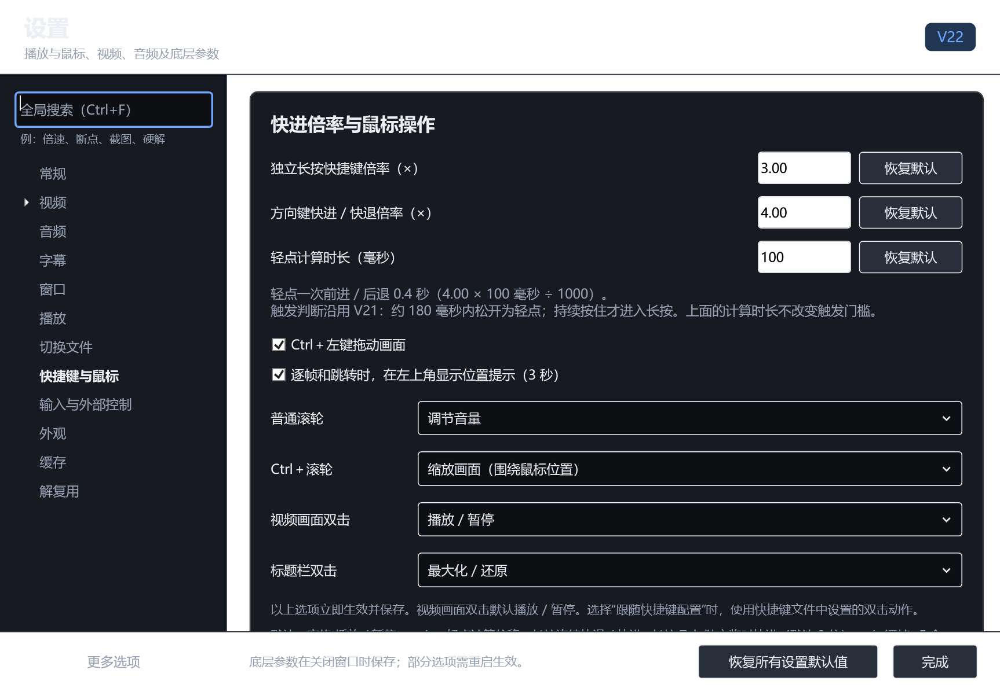

# V22 拉伸、导航设置、滚轮动作与恢复默认检查

检查日期：2026-10-12。Windows x64，V22（7.1.2.1022）。

## 拉伸画面和黑色背景

读取用户提供的缩放录屏，逐段检查黑色背景缺块、旧边缘残影及画面突变。此前只隐藏工具栏内容，视频 GPU 窗口、工具栏背景和父窗口仍分别改变尺寸、绘制，尺寸和圆角检查通过不足以证明画面稳定。

本版在真正改变尺寸时使用一个不透明、完整缓冲的预览层，统一绘制拖动开始时的当前帧、画面外黑区与工具栏占位区域。整个 GPU 视频宿主及上下栏暂时隐藏，并保留原尺寸；不是只隐藏按钮。每次预览绘制先填满纯黑，再按比例绘制画面。外框圆角继续随尺寸更新，八个拉伸目标仍位于外缘。

松开时消费最后一个待处理尺寸，在预览层下面恢复最终布局，视频窗口只提交一次尺寸变化。核对 `osd-dimensions` 和实际 `screenshot-raw window` 尺寸后揭开预览，恢复实时视频和蓝色栏。最多等待约 600 ms，超时会单独计数，避免预览一直停留。测试中的超时计数为零。

切换 `Dock=None` 时 WinForms 会还原更早的未停靠矩形，首次实验发现视频短暂缩为 200×100；已暂停子布局并显式保留当前矩形，消除此中间尺寸。

这项处理的代价是：拖动期间画面显示起始帧并随窗口缩放，声音与播放时间继续；松开后恢复当前实时帧。实际 GPU 窗口不在拖动期间反复缩放。测试没有证明所有显卡驱动都能消除所有瞬时闪烁。

两次连续测试共 120 个中间尺寸，包含图标与显示文字模式、收缩和放大、按钮溢出、最后一次排队尺寸、外框圆角及背景像素检查。每个预览的四个角均为黑色，隐藏的 GPU 始终保持原尺寸，松开后确认最终 GPU 渲染尺寸，捕获失败及揭开超时均为零。每次松开只排列工具栏一次，默认六个不同按钮保持不变。

Computer Use 使用隔离配置和实际课程视频执行右下角、底边两次鼠标收缩；记录两次捕获、两次最终视频提交，无捕获失败、超时或工具栏状态断言失败。观察稳定结束画面，未用静态设计图代替实际窗口。本地记录为 `test-results/appearance-v22/default/observations.json`。

实际课程原视频右侧黑区中已编码的灰色小块继续按原内容显示；独立原始帧证据见 V20 记录。没有擦除或覆盖源视频内容。此前窗口边缘残影与内容缺块是另一个问题，按本版预览流程处理。

## 轻点、方向键长按与独立长按键

- 方向键轻点、长按共用独立的绝对倍率，左右仅符号不同，不乘底部普通播放倍率。
- 轻点计算时长另存，实时显示 `方向倍率 × 毫秒 ÷ 1000` 的秒数。例如 4.00×、100 ms，轻点前进或后退 0.4 秒。
- 触发方式沿用 V21 的 40 ms 计时器、约 180 ms 判断，轻点松开时定位；计算时长不参与轻点 / 长按判定。
- 独立长按快进默认 Tab、3.00×，倍率与普通播放和方向键分开。可以改键或清除；短按此键不做方向键小步定位。
- 松开、失去焦点、切换视频、修改设置或开始拖动进度时恢复原倍率与暂停状态。临时倍率不写入普通播放倍率。
- V21 已有配置按当时实际向前倍率迁移一次，例如保存普通倍率 1.25× 会迁移为方向倍率 5.00×、轻点计算 24 ms，维持约 0.12 秒的轻点幅度。随后普通倍率与它不再联动。快退改为与向前同一倍率，消除旧实现的方向不对称。
- 单项恢复使用对应默认值；全局工厂默认为方向键 4.00×、30 ms，独立长按 3.00×。

实际消息测试覆盖底部 2×、方向 4×、独立 3×同时存在，左右 0.4 秒轻点、将计算时间设为 1000 ms 仍按约 180 ms 进入长按、Tab 的物理消息预处理和松开恢复。长按进度条、底部时钟及左上角时间戳 / 百分比同步，保留 V21 全屏与三秒提示回归。

## 滚轮可配置

移除“Ctrl＋滚轮缩放 / Ctrl＋拖动画面”捆绑开关和固定普通滚轮音量开关，改为两个独立下拉框与独立 Ctrl 拖动开关。

普通滚轮和 Ctrl＋滚轮各可选择音量、围绕鼠标缩放、普通播放倍率、按轻点位移前进 / 后退、不执行操作、跟随快捷键配置。默认仍为普通滚轮音量、Ctrl 滚轮缩放、Ctrl 拖动开启。旧普通滚轮关闭状态迁移为不执行，旧 Ctrl 操作关闭状态迁移为原生滚轮配置和拖动关闭。

跟随配置通过原生 `WHEEL_UP` / `WHEEL_DOWN` 或 `Ctrl+WHEEL_UP` / `Ctrl+WHEEL_DOWN` 绑定执行，前端不追加音量或缩放。两种高精度滚轮的部分刻度分别累计；Shift、Alt 和横向滚轮仍走原有输入处理。普通滚轮倍率使用播放倍率的调整步长，滚轮导航使用配置的轻点位移。

验证交换两种动作、关闭拖动仍缩放、倍率步长、停用后不执行原生音量动作、普通与 Ctrl 的半刻度分别累计、自定义三个原生滚轮绑定及两个真实 WPF 下拉框保存。一次轮动只执行一次。

## 所有设置恢复默认

设置底部提供“恢复所有设置默认值”。恢复前复制六类现有配置到 `settings-backups/时间戳`，包括 `mpv.conf`、`mpvnet.conf`、`input.conf`、`modern-ui.json`、`settings.xml` 和主题配置。不存在的文件不创建假备份。

恢复所有公开现代偏好属性，自动包含本次新增的倍率、轻点时长和滚轮动作；同时恢复原生配置、键鼠绑定、工具栏、播放模式、窗口参数、普通速度与音量，重新构建设置窗口控件，避免旧编辑值再次写回。原生需重启的部分显示说明。

断点、书签与最近文件是记录，保留。测试实际点击按钮并检查备份、重新打开配置、工厂默认值、已有自定义键消失、默认空格立即有效及记录保留。

## 验证记录

| 检查 | 结果 | 本地记录 |
| --- | --- | --- |
| 设置模型、旧配置迁移、共享记录及完整恢复 | 124 项通过 | `test-results/settings-v22.log` |
| 窗口消息、实际 GPU、长按 / 轻点、滚轮、拖动、WPF 设置与全局恢复 | 85 项通过，无失败 | `test-results/controls-v22/live/observations.json` |
| 连续拉伸完整预览及最终 GPU 渲染 | 120 个尺寸、两次手势通过 | `test-results/resize-v22/live/observations.json` |
| 实际课程窗口鼠标收缩 | 两次手势，状态断言无失败 | `test-results/appearance-v22/default/observations.json` |
| 多窗口断点与显式起点 / 零秒 | 8 项通过 | `test-results/resume-audit-v22/results.json` |
| 编译图标 | 7 种尺寸与蓝色源图一致 | `test-results/resize-v22/icons-compiled.json` |

构建无错误，保留上游已有的可空性警告；离线 NuGet 漏洞查询不可用。Windows 沙箱不允许连接新测试进程的管道，IPC 检查使用同一工作区的隔离配置在沙箱外完成。测试没有修改现用播放器或用户配置。

外观探针在设置模态窗口仍打开时退出等待超时；其两次拉伸断言和记录已完成，清理关闭了自身测试进程。主要控件测试正常关闭设置及播放器。

发行版和源码包由 `scripts/package.py` 创建，排除测试配置、断点、私有帧及缓存。CRC、依赖、源码和三个 SHA256 的校验见 `test-results/resize-v22/package-check.json`。
