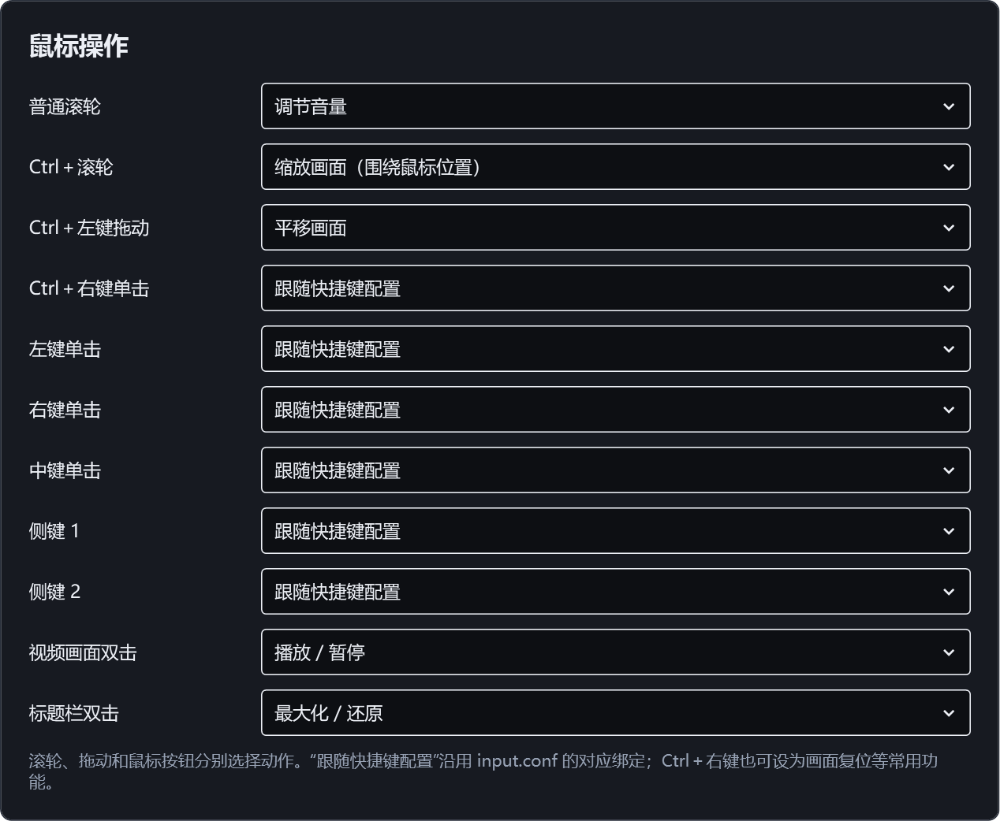

# V23 设置分区、多窗口与内存检查

检查日期：2026-10-12。Windows x64，V23（7.1.2.1023）。

## 快捷键提示与鼠标布局

按用户确认的布局，保留同一个“快捷键与鼠标”页面，操作设置分为三个独立区域：

- 快进倍率：独立长按倍率、方向键倍率、轻点计算时间、实时换算秒数及各项恢复默认。
- 鼠标操作：统一使用操作名称与动作选择行，包括普通滚轮、Ctrl＋滚轮、Ctrl＋左键拖动、Ctrl＋右键单击、普通鼠标与侧键、画面和标题栏双击。
- 画面提示：左上角定位提示选择“显示时间与百分比（3秒）”或“不显示”；不影响音量等其他操作提示。

Ctrl＋左键拖动可以选择平移画面、不执行操作或跟随快捷键配置，与滚轮设置独立。选择“不执行操作”时消费完整手势并在松开时释放鼠标捕获，即使先松开 Ctrl 也不会留下拖动状态。旧配置的拖动开关迁移为对应动作，全部恢复默认自动包含新字段。

Ctrl＋右键单击可以选择播放、静音、菜单、全屏、切换视频、画面复位、逐帧等常用命令，或选择不执行及跟随配置。测试从实际下拉框选择静音、调用原生按键 API，确认静音切换及保存；切回跟随配置后移除覆盖并恢复原绑定。其他已保存的自定义鼠标命令继续显示。

主窗口右键菜单及设置“更多选项”菜单删除键盘快捷键文字，避免修改绑定后显示旧提示。菜单动作及快捷键录入表继续工作；章节时间和轨道序号属于内容信息，继续保留。

预览直接由实际 WPF 设置控件渲染，完整鼠标区域与反馈区域分别渲染，未使用静态设计图替代控件。

## 设置与截图内存

此前遍历分类会一直保留已经创建的原生设置视图，测试中保留到 163 个。V23 按最近使用顺序管理视图，超过 32 个缓存预算时优先移除隐藏控件；大型分类的当前可见控件不会被强制移除。设置模型保留编辑值，返回该项时重建控件，关闭时保存后释放全部设置视图。实际测试编辑截图命名模板、遍历其他分类触发淘汰、返回并关闭，核对编辑值与配置文件都正确。

切换原生分类或搜索时，不再重建隐藏的常用快捷键行。截图从原生帧直接绘制到拥有独立存储的位图，避免整张托管字节数组再复制到位图；回调结束后释放原生截图内存。正常截图仍保留原分辨率。仅临时拉伸预览限制最长边为 1600 像素，确认 GPU 最终尺寸时只读取尺寸，不再创建整帧托管数组。

同一台机器、同一 1080p 本地课程视频，初始窗口 2400×1400、DPI 168、D3D11 硬件解码。每次测量执行四轮打开设置、遍历分类、搜索和修改，关闭后等待，再执行 24 次尺寸手势。对照结果如下，单位 MiB：

| 指标 | 修改前 | V23 最终对照 |
| --- | ---: | ---: |
| 采样最高工作集 | 594.6 | 576.3 |
| 采样最高私有内存 | 757.3 | 742.8 |
| 整轮累计托管分配 | 1173.3 | 448.3 |
| 设置关闭、诊断回收后保留的托管对象 | 32.9 | 16.7 |
| 最多保留的原生设置视图 | 163 | 32 |

累计分配减少约 61.8%，表示整轮运行反复申请内存的总量，不是同时占用 1173 MiB。工作集降幅较小，进程内存仍包含原生解码、渲染、WPF 和运行时资源，不能把差额全部认定为某一种显存或泄漏。首轮优化的采样最高工作集为 533.1 MiB，最终轮为 576.3 MiB，说明场景和运行时波动明显；报告使用最终轮结果，不选择更低一轮宣传。

900 MiB 未在本次测量中复现，不能据此断言其全部原因已找到，也不提供所有视频、驱动和窗口尺寸下的固定内存上限。读缓存约 0.06–0.2 MiB，没有证据认为这是缓存了整个视频。关闭后的前几轮设置窗口可回收，最新窗口弱引用在测量时仍存活；该记录不能证明全部原生资源立即释放。

诊断强制 GC 只在测试程序中用于区分存活对象与待回收对象。产品没有强制 GC、清空工作集或用此类操作降低任务管理器数字。原始记录：`test-results/memory-v23/baseline/observations.json`、`optimized-final/observations.json` 与 `comparison.json`。

## 多窗口

用户现用 `C:/App/mpvnet-modern/portable_config/mpvnet.conf` 选择了 `process-instance=single`。此模式将外部新文件转交给已有窗口，所以再次打开会切换当前视频。程序已有独立进程模式，设置位于“常规 → 打开文件时的进程方式 → 独立进程（multi）”。完成设置后，从外部再次打开文件可以创建另一个窗口；在播放器内部打开文件或点击列表仍切换该窗口的视频。

本次测试让两个普通启动读取同一份含 `process-instance=multi` 的隔离配置，未使用命令行覆盖进程方式。两个不同 PID 同时存活，分别使用 GPU 播放不同文件，两边时间位置都继续增加。验证记录为 `test-results/multiple-v23/results.json`。没有修改用户现用播放器、关联或配置，发行默认仍保留单进程。

## 回归与发行检查

| 检查 | 结果 | 本地记录 |
| --- | --- | --- |
| 设置模型、迁移与恢复默认 | 128 项通过 | `test-results/settings-v23.log` |
| 消息输入、键鼠、三个设置区域、缓存淘汰与保存 | 95 项通过 | `test-results/controls-v23/live/observations.json` |
| 拉伸预览、纯黑背景与最终渲染尺寸 | 120 个尺寸、两次手势通过 | `test-results/resize-v23/live/observations.json` |
| 原生截图、独立位图、预览上限、尺寸读取 | 14 项通过 | `test-results/screenshot-v23.log` |
| 两个普通启动读取同配置、独立播放 | 通过 | `test-results/multiple-v23/results.json` |
| 四轮设置与 24 次拉伸内存对照 | 两轮无失败 | `test-results/memory-v23/comparison.json` |
| 多窗口共享断点、显式时间戳与零秒 | 8 项通过 | `test-results/resume-audit-v23/results.json` |
| 编译图标 | 7 种尺寸与蓝色源图一致 | `test-results/resize-v23/icons-compiled.json` |

截图测试跳过两项修改系统剪贴板的检查，避免覆盖用户剪贴板；保存、像素、位图所有权及原生资源释放检查通过。交互测试中已覆盖视频窗口的 Win32 按键路径；轻点计算时间与长按门槛的专门测试使用原生明确按键 API，避免模拟消息受到用户实时键盘修饰键状态影响。

构建无错误，保留上游已有可空性警告；离线 NuGet 漏洞数据查询不可用。IPC 检查使用自身测试进程和隔离配置，Windows 沙箱管道限制由沙箱外测试解决。发行包排除测试配置、断点、私有帧及缓存；运行包、源码包和 SHA256 由 `scripts/package.py` 生成，校验记录为 `test-results/resize-v23/package-check.json`。
