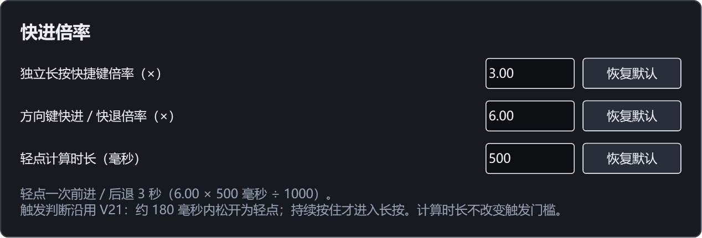

# V25 默认值与平滑圆角检查

检查日期：2026-10-12。Windows x64，V25（7.1.2.1025）。按用户要求使用 V25，版本编号继续跳过含 4 的编号。

## 导航默认值

| 项目 | V25 工厂默认 |
| --- | --- |
| 独立长按快捷键倍率 | 3.00× |
| 方向键快进 / 快退倍率 | 6.00× |
| 轻点计算时长 | 500 毫秒 |
| 轻点一次移动 | 3 秒（6.00 × 500 ÷ 1000） |

新配置、三个单项“恢复默认”和全局“恢复所有设置默认值”采用同一组工厂值。500 毫秒只用于换算位移，V21 的 40 毫秒计时器及约 180 毫秒轻点 / 长按判定保持原行为。独立长按倍率仍与方向键及底部普通播放倍率分开。

已有用户设置的当前倍率与计算时长保留。V21 升级仍迁移原操作速度和轻点幅度，但旧版记录的迁移恢复值不再覆盖本版工厂恢复值；保存时将默认目标字段统一为 6.00×、500 毫秒。空配置从本版工厂值启动，不误判为旧版配置而迁移回 4×、30 毫秒。恢复默认时保留断点、书签和最近文件的流程继续沿用。

## 蓝色栏圆角

原蓝色栏使用 Win32 窗口区域裁剪整个栏及子控件。该区域只保留或删除完整像素，原始四角捕获的蓝黑边界没有中间色，放大后呈阶梯状。

V25 在蓝色栏自己的缓冲画布上，以抗锯齿路径绘制 `#0096FF` 的四个圆角，曲线边缘平滑过渡到黑色背景，不再给蓝色栏使用二值窗口区域。半径仍为 10 个逻辑像素并随 DPI 变化。中间子控件左右避开圆角，原有文件名字体仍为 10 磅，图标与分组保持；安全内缩替代原有边距，避免叠加空白和移动右侧按钮。

播放器外框的圆角及八个拉伸目标继续由原流程管理。拉伸期间仍使用完整黑色缓冲预览，蓝色栏与 GPU 宿主隐藏并冻结尺寸；松开后一次性恢复最终尺寸及栏内容。本次未改 GPU、透明窗口或视频合成方式。

以下图片把实际四个角按左上、右上、左下、右下放大并拼放，保留原像素颜色以便检查：

修改前：

V25：

175% DPI 的实际栏控件捕获，四角均存在数十个蓝黑中间色像素，原版均为零。测试同时确认新栏没有会切断抗锯齿边缘的原生裁剪区域。整个栏和放大角图均由自身 WinForms 控件渲染；基线捕获额外应用原生区域，因为 `WM_PRINT` 不总是自动应用窗口区域。

## 验证

| 检查 | 结果 |
| --- | --- |
| 设置模型、默认值、迁移、存储与恢复 | 132 项通过 |
| 实际窗口、键鼠、单项及全局恢复、四角像素与设置缓存 | 99 项通过 |
| 完整拉伸预览、外框及最终 GPU 尺寸 | 120 个尺寸、两次手势通过 |

- 设置模型检查包含空配置的新默认、旧配置保留当前值、旧默认目标更新、存储以及全局恢复。
- 真实 WPF 单项恢复检查覆盖 500 毫秒、6.00×，换算立即显示 3 秒；全局恢复采用同样工厂值，保留播放记录。
- 四角逐像素检查验证蓝黑颜色过渡；完整栏预览核对字体、按钮及圆角。
- 回归时发现暂停后的旧进度通知可能把快进松手误判为“下一帧”。结束长按时同步位置基线，暂停中的过时通知不参与逐帧推断；补充确定性回归，模拟排队的旧位置再送入当前位置，检查快进提示保持，并执行真实原生逐帧确认仍有正确提示。
- 120 个拉伸尺寸、两次手势检查完整黑色背景、外框圆角、冻结 GPU 尺寸、松开后的最终渲染及六个不同工具按钮。首次未传入媒体参数而等待超时，补上实际视频参数后完成全部 120 个尺寸；没有改产品以规避测试。

运行记录分别位于 `test-results/settings-v25.log`、`test-results/controls-v25/live/observations.json`、`test-results/controls-v25/preview/observations.json` 与 `test-results/resize-v25/live/observations.json`。编译保留上游可空性警告及离线 NuGet 漏洞数据查询警告。发行和源码包由 `scripts/package.py` 生成，CRC、源码一致性、私有数据排除及 SHA256 校验记录位于 `test-results/resize-v25/package-check.json`。
